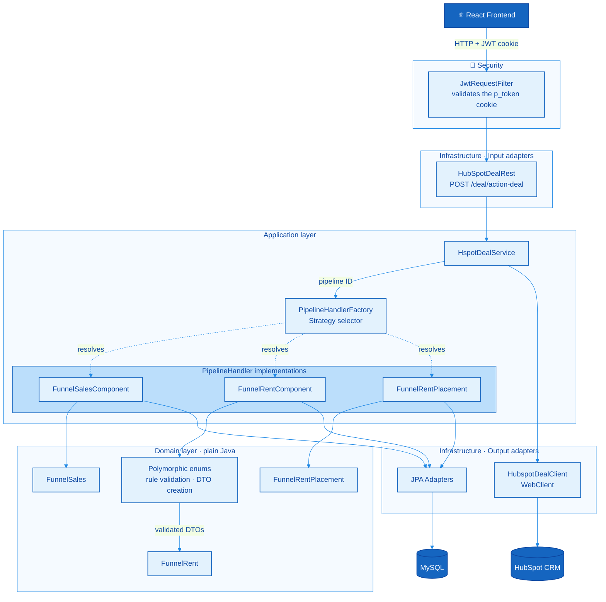
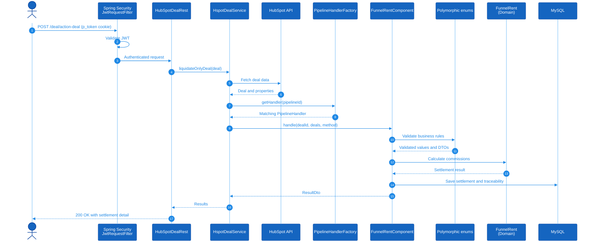
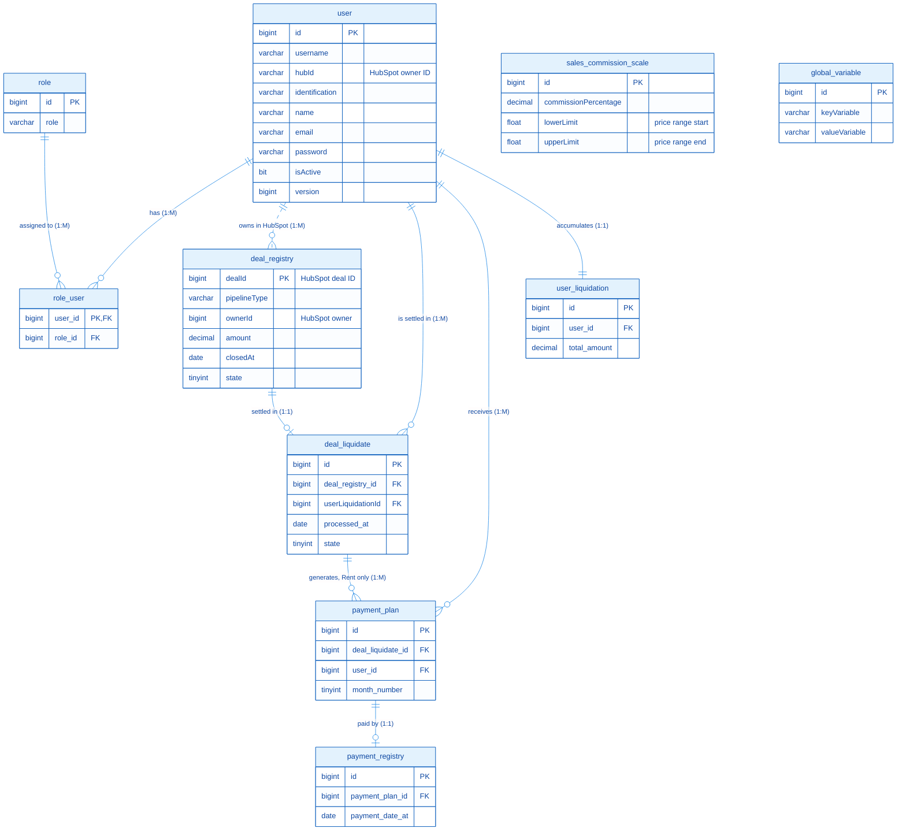

<!-- ===== HEADER ===== -->
<h1 align="center">🏠 Habitar Inmobiliaria — Commission Management API</h1>

<p align="center">
  Backend for managing and settling real estate agents' commissions, integrated with <b>HubSpot CRM</b>.
</p>

<!-- ===== BADGES (cambie la versión después del guion si actualiza) ===== -->
<p align="center">
  
  
  
  
  
  
</p>

<p align="center">
  <a href="https://github.com/COF9999/front-inmobiliaria">Frontend repository</a> ·
  <a href="#-getting-started">Getting Started</a> ·
  <a href="#-api-endpoints">API Endpoints</a>
</p>

---

## 📑 Table of Contents

- [Overview](#-overview)
- [Key Features](#-key-features)
- [Architecture](#-architecture)
- [Design Patterns](#-design-patterns)
- [Data Model](#-data-model)
- [Tech Stack](#-tech-stack)
- [Project Structure](#-project-structure)
- [Getting Started](#-getting-started)
- [Sample HubSpot Data](#-sample-hubspot-data)
- [Authentication](#-authentication)
- [API Endpoints](#-api-endpoints)
- [Testing](#-testing)
- [Lessons Learned](#-lessons-learned)
- [Author](#-author)

---

## 📌 Overview

Real estate agencies often calculate agent commissions by hand: exporting deals from the CRM, reviewing figures and updating values in spreadsheets. This process is slow and error-prone.

This API automates the entire flow. It pulls closed deals from **HubSpot**, applies the agency's configurable business rules and settles commissions with full traceability. Any range of months can be settled **in seconds**, cutting overall process time by **over 90%**.

The system was built as **custom software for Habitar Inmobiliaria**, and its design makes it adaptable to other agencies with different business models.

> 🖥️ **See it in action:** the [frontend repository](https://github.com/COF9999/front-inmobiliaria) shows how the system works from the user's side: importing deals from HubSpot, pre-settlement and settlement actions, user management, global variables and the control panel.

---

## ✨ Key Features

- **HubSpot CRM integration:** fetches deals and owners through the HubSpot API and registers them in the system.
- **Multiple business lines:** handles *Sales*, *Rent* and *Rent Placement* funnels, each with its own settlement rules.
- **Pre-settlement and settlement:** calculates commissions per agent and generates settlement reports by date range.
- **Configurable business rules:** commission scales, contract durations and percentages are managed as global variables, without changing code.
- **User and role management:** agent registration, role changes and administration.
- **Secure authentication:** stateless JWT sent in an `HttpOnly` cookie.
- **Centralized error handling:** custom exceptions mapped to consistent HTTP responses.

---

## 🏛️ Architecture

The project follows **Hexagonal Architecture (Ports & Adapters)**. Business calculations live in plain Java domain classes, free of Spring, while frameworks, the database and the HubSpot API stay at the edges as adapters that can be replaced without rewriting the core logic.

### Layered view



### Request flow: settling a Rent deal



| Layer | Package | Responsibility |
|---|---|---|
| **Domain** | `domain` | Business rules, polymorphic enums, settlement logic per funnel, output ports and DTOs |
| **Application** | `application` | Use cases, pipeline handlers and HubSpot commands that orchestrate the domain |
| **Infrastructure** | `infraestructure` | REST controllers, JPA adapters, HubSpot client, configuration and exception handling |
| **Global** | `global` | Generic CRUD port and security configuration (Spring Security + JWT) |

---

## 🧩 Design Patterns

**Strategy.** Each HubSpot pipeline (Sales, Rent, Rent Placement) has its own `PipelineHandler` implementation. The `PipelineHandlerFactory` picks the right strategy at runtime based on the pipeline ID, so adding a new business line means adding a new handler, without modifying existing code.

**Visitor.** `VisitorExtractSales` separates the operations performed on settlement structures (`DetailPaymentFunnel`, `Resume`) from the structures themselves. New calculations or exports can be added without changing those classes.

### Polymorphic enums: business rules as constants

Business rules and system variables are mapped to **enum constants with their own behavior** (constant-specific methods). They belong to the domain, but they run **one step before** the funnel implementations. In the Rent funnel, where the business rules are more complex, `FunnelRentComponent` calls them first to validate the rules and build temporary transport objects (DTOs), so `FunnelRent` only receives valid data.

#### 1. HubSpot properties mapped to constants

Every HubSpot field the system reads is declared once as a constant, instead of scattering text strings through the code:

```java
public enum PropertiesHubspot {
    AMOUNT("amount"),
    CLOSEDATE("closedate"),
    HUBSPOT_OWNER_ID("hubspot_owner_id"),
    DEALNAME("dealname"),
    DEALSTAGE("dealstage"),
    PIPELINE("pipeline");

    private final String value;
    private static final List<String> listCommonProperties;

    static {
        listCommonProperties = Arrays.stream(values())
                .map(PropertiesHubspot::getValue)
                .sorted() // constant alphabetical order in the request URL
                .toList();
    }
}
```

If HubSpot renames a property, only one line changes. The list is built **once**, when the class loads, and sorted alphabetically so every request to HubSpot is built the same way.

#### 2. Each funnel declares the data it needs

Each funnel overrides an abstract method to declare which HubSpot properties it requires. Rent reuses the common properties and adds its own, with no duplication:

```java
public enum HubspotEnum {
    FUNNELSALES {
        @Override
        public List<String> extractProperties() {
            return PropertiesHubspot.Sales.getPropertiesSales();
        }
    },
    FUNNELRENT {
        @Override
        public List<String> extractProperties() {
            return PropertiesHubspot.Rent.getListPropertiesRent();
        }
    };

    public abstract List<String> extractProperties();
}
```

```java
public enum Rent {
    LISTINGAGENT("captador_del_inmueble"),
    CONTRACTDURATION("duracion_del_contrato") { /* own rule, see below */ };

    public static List<String> getListPropertiesRent() {
        return Stream.concat(
                PropertiesHubspot.Sales.getPropertiesSales().stream(),
                listRentProperties.stream())
            .collect(Collectors.toList());
    }
}
```

Because `extractProperties()` is abstract, adding a new funnel without implementing it **does not compile**, so no business line can be left incomplete.

#### 3. Business rules validated inside the constant

Only the contract duration knows how to interpret its own value. It overrides `extractNumber` and validates it against the durations allowed by the business, which are themselves an enum:

```java
CONTRACTDURATION("duracion_del_contrato") {
    @Override
    public Integer extractNumber(String contractDuration) {
        if (contractDuration == null) {
            throw new BadRequestException("El campo de la duración del contrato esta nulo");
        }
        try {
            int num = Integer.parseInt(contractDuration.replaceAll("\\D+", ""));
            if (Duration.ALLOWED_MONTHS.contains(num)) {
                return num;
            }
        } catch (NumberFormatException ignored) {}
        throw new BadRequestException("Duración no permitida. Solo se acepta: " + Duration.ALLOWED_MONTHS);
    }
};

private enum Duration {
    SIX_MONTHS(6), TWELVE_MONTHS(12);
    // ALLOWED_MONTHS: unmodifiable Set built once from these constants
}
```

Any other constant that calls `extractNumber` throws `UnsupportedOperationException`, so misuse fails immediately instead of producing wrong results. Allowing a new duration, such as 3 months, only means adding one constant.

#### 4. The same approach across the system

The same technique is applied to other business rules and system variables, such as `PipelineType`, which maps each HubSpot pipeline ID and its closing stages:

```java
public enum PipelineType {
    FUNNEL_RENT("80031012", "Funnel Rent", List.of("151455346")),
    FUNNELSALES("default", "Funnel Sales", List.of("closedwon")),
    FUNNELRENTPLACEMENT("667146145", "Funnel Rent Placement", List.of("978989448"));
}
```

Along with `FunnelRentEnum`, `DealStateEnum`, `CalendarYear` and `StatesObjects`, this keeps every configuration **centralized and separated from the business logic**. When something fails, the error points directly to the specific rule or constant involved, which makes debugging fast.

#### Benefits

- **No `if` / `switch` chains:** each constant carries its own behavior.
- **Compile-time safety:** abstract methods force every new funnel to implement its rules.
- **Open/Closed Principle:** new business lines or rules are added as new constants, without touching existing logic.
- **Single source of truth:** HubSpot properties, pipelines and allowed values are defined in one place.
- **Fast debugging:** failures are traced to the exact rule, with clear error messages.
- **Performance and thread safety:** enum constants are immutable singletons, and their lists are precomputed once in static blocks instead of on every request.

---

## 🗄️ Data Model

The data model is intentionally small. Its strength is that **a handful of tables supports dozens of business lines**: each line is added as a new Strategy (`PipelineHandler`) that reuses the same tables and its own global variables, without changing the schema.



| Relationship | Cardinality |
|---|---|
| `user` ↔ `role` (through `role_user`) | **M:M** |
| `user` → `deal_registry` | **1:M** (logical, via HubSpot owner ID) |
| `deal_registry` → `deal_liquidate` | **1:1** |
| `user` → `deal_liquidate` | **1:M** |
| `deal_liquidate` → `payment_plan` | **1:M** (Rent only) |
| `user` → `payment_plan` | **1:M** |
| `payment_plan` → `payment_registry` | **1:1** |
| `user` → `user_liquidation` | **1:1** |

> The dashed line between `user` and `deal_registry` is a logical relationship: deals are linked to agents through their HubSpot owner ID (`hubId`), not through a database foreign key.

### How the tables work together

**Deals and settlements.** `deal_registry` stores the deals imported from HubSpot, and `deal_liquidate` records each settlement with its processing date and state. Each settlement is linked directly to the user it belongs to, so a user can accumulate many settlements over time.

**Commission payouts.** Each user has one `user_liquidation` record with the total amount settled to them. It includes both the agents who work at Habitar and the **main account**, which is the agency itself, since it always bills a share of every deal.

For example, in the **Sales** funnel, when a house worth **COP 800M** is sold, the system finds the price range that contains it in `sales_commission_scale`, together with the values configured in the **global variables**. With that, it calculates the commission for the agency and for the agent, and those amounts are recorded in `user_liquidation`.

**Configuration tables.** `sales_commission_scale` defines the commission percentage for each price range (`lowerLimit` to `upperLimit`), and `global_variable` stores the business variables as key-value pairs. Neither has foreign keys, because they are configuration read by the funnels, which lets each agency adjust its rules without touching the code.

**Rent payment plans.** `payment_plan` and `payment_registry` are used only by the **Rent** funnel. A rent deal is a lease contract, so the system generates its payment plan for **6 or 12 months**, with one row per month. `payment_registry` records each month when it is paid.

The plan generation logic is **decoupled from the accounting conventions** each agency uses, such as the commercial 360-day year with 30-day months. The same system can adapt to different agencies just by switching the technique, without modifying the plan structure.

---

## 🛠️ Tech Stack

| Category | Technologies |
|---|---|
| Language | Java 21 |
| Framework | Spring Boot 3.5 (Web, Data JPA) |
| HTTP client | Spring WebFlux (`WebClient`) for the HubSpot API |
| Security | Spring Security, JWT (jjwt 0.12.6) |
| Database | MySQL (MySQL Connector/J) |
| Integration | HubSpot API, `hubspot-api-java-client` |
| Utilities | Lombok, Apache Commons Codec |
| Build | Maven (wrapper included) |
| Testing setup | Spring Boot Test, Spring Security Test, Reactor Test, Mockito |
| Dev tools | Spring Boot DevTools |

---

## 📂 Project Structure

```
src/main/java/com/realstate/habitar
├── domain/                  # Core business logic (framework-independent)
│   ├── baselogic/           # Settlement logic per funnel and Visitor interfaces
│   ├── dispactchers/        # PipelineHandler (Strategy) and pipeline types
│   ├── ports/               # Output ports (HubSpot, users, roles)
│   ├── rules/               # Business rules (dates, exports)
│   ├── predicates/          # Reusable filtering predicates
│   ├── converters/          # JPA attribute converters
│   ├── enums/               # Deal states, funnels and calendar
│   ├── hubspot/             # HubSpot search query model
│   └── dtos/                # Domain records and DTOs
├── application/             # Use cases
│   ├── usecases/            # Use case interfaces (input ports)
│   ├── implementations/     # Use case implementations and HubSpot commands
│   └── components/          # Funnel components (Sales, Rent, Rent Placement)
├── infraestructure/         # Adapters
│   ├── rest/                # REST controllers
│   ├── adapters/            # JPA repositories and HubSpot client (port implementations)
│   ├── classes/model/       # JPA entities
│   ├── config/              # HubSpot client, cache, async and startup config
│   └── advicers/            # Global exception handling
├── global/
│   ├── domain/ports/        # Generic CRUD port
│   └── security/            # Spring Security and JWT filters
└── utils/                   # Shared helpers
```

---

## 🚀 Getting Started

### Prerequisites

- **JDK 21**
- **Docker** and **Docker Compose** (or a local MySQL 8+ installation)
- A **HubSpot private app** with access to deals and owners

### 1. Clone the repository

```bash
git clone https://github.com/COF9999/backend-inmobiliaria.git
cd backend-inmobiliaria
```

### 2. Start the database with Docker

```bash
docker compose up -d
```

This starts two containers:

| Service | URL | Description |
|---|---|---|
| **MySQL 8** | `localhost:3309` | Database `hubspot_integration`, created automatically |
| **phpMyAdmin** | [http://localhost:8090](http://localhost:8090) | Web interface to inspect the data |

<details>
<summary><b>View <code>compose.yml</code></b></summary>

```yaml
version: "3.9"

services:
  db:
    image: mysql:8.0.36
    container_name: mysql_hubspot
    restart: unless-stopped
    ports:
      - "3309:3306"
    environment:
      MYSQL_ROOT_PASSWORD: admin123
      MYSQL_DATABASE: hubspot_integration
      MYSQL_USER: user
      MYSQL_PASSWORD: habitar123
    command:
      --character-set-server=utf8mb4
      --collation-server=utf8mb4_unicode_ci
    volumes:
      - db_data:/var/lib/mysql
    networks:
      - mysql-phpmyadmin

  phpmyadmin:
    image: phpmyadmin:5.2
    container_name: phpmyadmin_hubspot
    depends_on:
      - db
    restart: unless-stopped
    ports:
      - "8090:80"
    environment:
      PMA_HOST: db
      PMA_USER: root
      PMA_PASSWORD: admin123
    networks:
      - mysql-phpmyadmin

networks:
  mysql-phpmyadmin:
    driver: bridge

volumes:
  db_data:
```

</details>

The credentials in `compose.yml` are meant for **local development only**. Tables are created on the first startup of the application (`ddl-auto=update`), and `app.db.init.enabled=true` loads the initial data.

> **Without Docker:** create the database manually with `CREATE DATABASE hubspot_integration;` on your local MySQL server.

### 3. Configure the application

Configuration files are not versioned for security reasons. Secrets are kept in a local `.env` file, which Spring Boot imports on startup:

```bash
cp .env.example .env    # then replace the values
```

Then create `src/main/resources/application.properties`. Its first line imports the `.env` file, and every `${...}` value is read from it:

```properties
# Loads the variables from the .env file in the project root
spring.config.import=optional:file:.env[.properties]

spring.application.name=habitar
server.port=8080

# ===== Database =====
spring.datasource.url=${DB_URL:jdbc:mysql://localhost:3309/hubspot_integration?useSSL=false&allowPublicKeyRetrieval=true&serverTimezone=UTC}
spring.datasource.username=${DB_USERNAME}
spring.datasource.password=${DB_PASSWORD}
spring.datasource.driver-class-name=com.mysql.cj.jdbc.Driver
spring.jpa.hibernate.ddl-auto=update
spring.jpa.hibernate.naming.physical-strategy=org.hibernate.boot.model.naming.PhysicalNamingStrategyStandardImpl

# ===== Security =====
config.secret.key=${JWT_SECRET}
config.generic.key=${GENERIC_KEY}
config.my.local.ip=${ALLOWED_IP}

# ===== Initial data =====
app.db.init.enabled=true

# ===== HubSpot =====
hubspot.baseurl=https://api.hubapi.com
hubspot.api.deals=/crm/v3/objects/deals/search
hubspot.api.owners=/crm/v3/owners/
hubspot.dealapp.token=${HUBSPOT_TOKEN}

# ===== Global variable keys =====
config.keyowneraccount=account_owner
config.percentagesale=percentage_sale
config.listing.agent=listing_property
config.duration.contract=contract_duration
config.total.commissions.sixmonths=total_commissions_six_months
config.total.commissions.oneyear=total_commissions_one_year
config.commissions.ownersixmonths=commissions_owner_six_months
config.commissions.owneroneyear=commissions_owner_one_year

# ===== Export =====
config.export.path=${EXPORT_PATH:./exports/reporte_liquidacion.csv}
```

| Variable | Description |
|---|---|
| `DB_URL` | JDBC connection URL (optional, defaults to local MySQL on port 3309) |
| `DB_USERNAME` | Database user |
| `DB_PASSWORD` | Database password |
| `JWT_SECRET` | Secret used to sign JWT tokens (long random string) |
| `GENERIC_KEY` | Internal application key |
| `ALLOWED_IP` | IP address allowed for incoming requests |
| `HUBSPOT_TOKEN` | Access token of your HubSpot private app |
| `EXPORT_PATH` | Path where settlement reports are exported as CSV (optional) |

### 4. Run the application

```bash
# Linux / macOS
./mvnw spring-boot:run

# Windows
mvnw.cmd spring-boot:run
```

The API will be available at `http://localhost:8080`.

---

## 📦 Sample HubSpot Data

This project is no longer connected to the agency's HubSpot account, so live deals cannot be imported. The sample below shows the structure the system receives from the HubSpot API and processes. **All IDs, names and amounts are anonymized**, except the pipeline and stage IDs, which are the values mapped in `PipelineType`.

```json
[
  {
    "id": "10000000001",
    "ownerId": "20000001",
    "pipelineType": "FUNNEL_RENT",
    "properties": {
      "amount": "1880000",
      "closedate": "2025-02-01T13:37:53.705Z",
      "createdate": "2025-01-21T13:48:19.611Z",
      "dealname": "New rental process // Apartment 101 // Sample",
      "dealstage": "151455346",
      "hs_lastmodifieddate": "2025-12-12T15:15:46.731Z",
      "hs_object_id": "10000000001",
      "hubspot_owner_id": "20000001",
      "pipeline": "80031012"
    }
  },
  {
    "id": "10000000002",
    "ownerId": "20000002",
    "pipelineType": "FUNNELSALES",
    "properties": {
      "amount": "70000000",
      "closedate": "2025-08-28T21:13:48.658Z",
      "createdate": "2025-08-16T19:56:29.494Z",
      "dealname": "Apartment 906 // Sample Tower",
      "dealstage": "closedwon",
      "hs_lastmodifieddate": "2026-01-02T15:30:42.901Z",
      "hs_object_id": "10000000002",
      "hubspot_owner_id": "20000002",
      "pipeline": "default"
    }
  }
]
```

| Field | How the system uses it |
|---|---|
| `pipeline` | Identifies the business line. `PipelineHandlerFactory` uses it to pick the right strategy (`80031012` → Rent, `default` → Sales) |
| `dealstage` | Only deals in a closing stage are processed (`151455346` for Rent, `closedwon` for Sales) |
| `hubspot_owner_id` | Links the deal to the agent through the `hubId` field in `user` |
| `amount` | Base value for the commission calculation |
| `closedate` | Determines the settlement period |

Every property in `properties` is declared as a constant in the `PropertiesHubspot` enum, so the request to HubSpot always asks for exactly these fields.

---

## 🔐 Authentication

The API uses **stateless JWT authentication**.

1. Send the credentials to `POST /login`:

   ```json
   {
     "username": "your_username",
     "password": "your_password"
   }
   ```

2. On success, the server returns the token in an `HttpOnly` cookie named `p_token`, which protects it from being read by JavaScript (XSS).
3. The browser sends the cookie automatically on every request, and `JwtRequestFilter` validates it.
4. `GET /api/auth/verify` checks whether the current session is still valid.

---

## 📡 API Endpoints

| Method | Endpoint | Description |
|---|---|---|
| `POST` | `/login` | Authenticate and receive the JWT cookie |
| `GET` | `/api/auth/verify` | Verify the current session |
| **Users** | | |
| `POST` | `/user/register` | Register a new user |
| `POST` | `/user/change-role` | Change a user's role |
| `GET` | `/user/list` | List users |
| `GET` | `/user/{id}` | Get a user by ID |
| `PUT` | `/user/` | Update a user |
| `DELETE` | `/user/{id}` | Delete a user |
| **HubSpot deals** | | |
| `POST` | `/deal/register-deal` | Register a HubSpot deal in the system |
| `POST` | `/deal/deals-not-register` | List HubSpot deals not yet registered |
| `POST` | `/deal/action-deal` | Run pre-settlement or settlement on deals |
| `POST` | `/deal/report-date` | Generate a settlement report by date range |
| **Deal registry** | | |
| `POST` | `/deal-register/create` | Create a deal record |
| `GET` | `/deal-register/` | List deal records |
| `PATCH` | `/deal-register/update` | Update a deal record |
| **Settlements and payments** | | |
| `GET` | `/deal-liquidate/` | List settled deals |
| `GET` | `/process-deal/list` | List processed deals |
| `GET` | `/payment-plan/list` | List payment plans |
| `POST` | `/payment-realized/` | Register a completed payment |
| **Configuration** | | |
| `GET` | `/g-variables/` | Get global business variables |

---

## 🧪 Testing

The payment plan generation of the **Rent** funnel is covered by integration tests in `FunnelRentTest`, which run with the full Spring context (`@SpringBootTest`). They build a 12-month lease contract and check how each month of the plan is assigned to the agent or to the agency, following the settlement traceability.

```bash
# The database must be running (docker compose up -d)
./mvnw test
```

---

## 💡 Lessons Learned

This project is complete and no longer under active development. Building it taught me how to turn a real business process into maintainable software: applying **Hexagonal Architecture** in practice, using **Strategy** and **polymorphic enums** to support several business lines with a small data model, and integrating an external CRM like **HubSpot**.

Looking back, these are the improvements I would apply from the start in my next projects:

- **Keep the tests in the repository.** During fast development I deleted several unit tests once they passed. Today I would keep them versioned, because they document the expected behavior and protect it from future changes.
- **Write tests with assertions.** Verifying results with `assert` statements instead of printing them, and testing the domain as plain Java, without loading the Spring context.
- **Use AOP for cross-cutting validations.** Moving repeated validations into aspects with Spring AOP, so the business logic stays focused on its own rules as new validations appear.

---

## 👤 Author

**Christián Orjuela** — Software Engineer | Backend Developer

<a href="https://www.linkedin.com/in/christi%C3%A1n-orjuela/"></a>
<a href="https://github.com/COF9999"></a>

> Built as custom software for **Habitar Inmobiliaria**.
>
> Frontend: [COF9999/front-inmobiliaria](https://github.com/COF9999/front-inmobiliaria)
